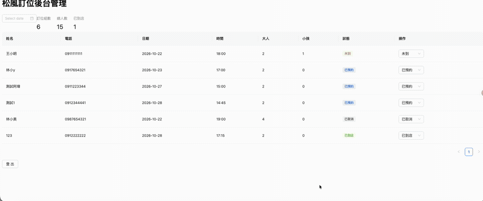

# 松風鍋物 訂位管理後台

[松風鍋物線上訂位](https://restaurant-reservation-practice.vercel.app) 的配套後台（練習作品），從店家的角度查看與管理訂位。

[後台線上版](https://songfeng-admin.vercel.app)（需店員帳號登入，可看下方 GIF 示範）

## 功能

- 訂位列表：姓名、電話、日期、時段、大人／小孩人數
- 依日期篩選
- 當日統計：訂位組數、總人數、已到店人數
- 訂位狀態以彩色標籤顯示（已預約／已到店／未到／已取消）



## 技術

- React + TypeScript + Vite
- Ant Design（Table、Tag、Select、DatePicker、Statistic）
- Supabase（PostgreSQL）：用 SQL 建立訂位資料表，開啟 Row Level Security

## 開發進度

- [x] 用 TypeScript 定義訂位型別（union type 限制狀態）
- [x] 從 Supabase 讀取訂位資料
- [x] 店家登入（讓電話只有登入後才看得到）
- [x] 前台送出的訂位寫入資料庫
- [x] 後台修改狀態寫回資料庫
- [x] 部署到 Vercel

## 本機執行

1. `npm install`
2. 在根目錄建立 `.env.local`，填入自己的 Supabase 專案網址和 publishable key：

```
VITE_SUPABASE_URL=
VITE_SUPABASE_PUBLISHABLE_KEY=
```

3. `npm run dev`
